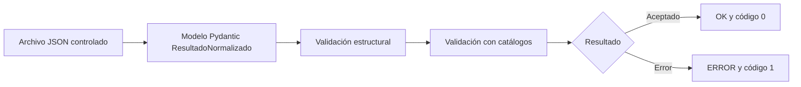

# Informe didáctico de la primera versión

**Proyecto:** modelo de evaluación automatizada de calidad web para el Portal Académico de la Universidad La Salle, Arequipa.  
**Incremento:** Sprint de implementación 1 de 4, versión `0.1.0`.  
**Alcance de este informe:** describe el código y las comprobaciones ejecutadas en esta copia del proyecto. Los JSON de ejemplo son **simulados y controlados**; ninguna conclusión aquí procede de medir el Portal Académico.

## 1. Presentación del proyecto

La tesis busca construir un modelo que pueda recibir información de distintas herramientas de calidad web, expresarla de forma común y, en incrementos futuros, producir un diagnóstico comprensible. En Design Science Research (DSR), el **artefacto** es la solución construida y evaluable: aquí, el modelo de datos, sus catálogos y el software que los hace ejecutables. La primera versión demuestra una base técnica verificable; todavía no demuestra la calidad del portal.

Este incremento define los campos `CR-01` a `CR-18`, conserva `datosOriginales`, modela evaluaciones y contextos, carga catálogos, valida la estructura de un resultado y comprueba la coherencia entre indicador y dimensión. Ofrece una interfaz de consola, tres entradas de ejemplo y nueve pruebas. Los ejemplos ya vienen expresados en el formato común: contienen valores inventados para ejercitar los validadores. Por ello, que aparezca `[OK]` significa que el **archivo tiene una estructura aceptada**, no que la página evaluada cumpla un criterio.

Todavía faltan lectores de reportes reales de WAVE, axe DevTools y Lighthouse, transformación automática a la estructura común, ejecución efectiva de varias reglas, clasificación por umbrales, consolidación e informe de diagnóstico. Esta separación coincide con el alcance declarado en `README.md` y `docs/arquitectura_tecnica.md`.

## 2. Resultado de la instalación y la verificación

Se trabajó en **Microsoft Windows 10.0.26200** con **PowerShell 5.1**. La raíz se localizó por `pyproject.toml`. El comando `py` del sistema respondió `No installed Python found!`; se utilizó `python`, que resolvió a Python **3.11.5**. Dentro de `.venv` se verificaron **pip 26.2.1** y **Pydantic 2.13.5**. El intérprete utilizado para instalar y comprobar fue `.venv\Scripts\python.exe`, dentro del proyecto. No se instaló ningún paquete globalmente. `pip` ya estaba disponible, por lo que no fue necesario `ensurepip`.

Comandos ejecutados en PowerShell desde la raíz:

```powershell
python --version
python -m pip --version
python -m venv .venv
.\.venv\Scripts\python.exe -m pip install --upgrade pip
.\.venv\Scripts\python.exe -m pip install -e .
$env:PYTHONIOENCODING='utf-8'
.\.venv\Scripts\python.exe -m modelo_calidad_web validar datos/ejemplos/wave_ejemplo.json datos/ejemplos/axe_ejemplo.json datos/ejemplos/lighthouse_ejemplo.json
.\.venv\Scripts\python.exe -m unittest discover -s tests -v
.\.venv\Scripts\python.exe -m pip check
```

La instalación editable terminó con `Successfully installed ... modelo-calidad-web-0.1.0 pydantic-2.13.5 ...`. `pip check` respondió `No broken requirements found.` La invocación directa de `.venv\Scripts\modelo-calidad-web.exe` también terminó con código `0` y aceptó los mismos tres ejemplos. La salida exacta de la repetición mediante `python -m`, configurando UTF-8 para que los acentos se muestren correctamente, fue:

```text
[OK] datos\ejemplos\wave_ejemplo.json: resultado válido
[OK] datos\ejemplos\axe_ejemplo.json: resultado válido
[OK] datos\ejemplos\lighthouse_ejemplo.json: resultado válido
```

Salida de las pruebas (nombres, resultado y tiempo medidos):

```text
test_acepta_indicador_y_dimension_coherentes (test_catalogos.CatalogosTest.test_acepta_indicador_y_dimension_coherentes) ... ok
test_carga_cantidades_definidas_en_el_diseno (test_catalogos.CatalogosTest.test_carga_cantidades_definidas_en_el_diseno) ... ok
test_rechaza_dimension_incompatible (test_catalogos.CatalogosTest.test_rechaza_dimension_incompatible) ... ok
test_rechaza_indicador_inexistente (test_catalogos.CatalogosTest.test_rechaza_indicador_inexistente) ... ok
test_acepta_resultado_valido (test_resultado.ResultadoNormalizadoTest.test_acepta_resultado_valido) ... ok
test_rechaza_campo_obligatorio_ausente (test_resultado.ResultadoNormalizadoTest.test_rechaza_campo_obligatorio_ausente) ... ok
test_rechaza_hallazgo_sin_evidencia (test_resultado.ResultadoNormalizadoTest.test_rechaza_hallazgo_sin_evidencia) ... ok
test_rechaza_herramienta_no_reconocida (test_resultado.ResultadoNormalizadoTest.test_rechaza_herramienta_no_reconocida) ... ok
test_rechaza_metrica_sin_unidad (test_resultado.ResultadoNormalizadoTest.test_rechaza_metrica_sin_unidad) ... ok

----------------------------------------------------------------------
Ran 9 tests in 0.003s

OK
```

No hubo errores ni advertencias en esas pruebas. Además, se cargaron con `json.loads` los **ocho JSON** del proyecto (cinco catálogos y tres ejemplos), se compilaron con `py_compile` los **doce archivos Python** de `src/` y `tests/`, y se comprobaron por código las cantidades **3 dimensiones, 20 indicadores, 5 estados, 5 prioridades y 10 reglas**. Todos esos controles terminaron sin error. Las entradas inválidas que cubren las pruebas fueron rechazadas como se esperaba. La instalación se realizó desde un entorno virtual recién creado y se ejecutó desde ese entorno. El mensaje `[OK]` no verifica si el contenido simulado es verdadero ni si una regla de normalización se aplicó automáticamente.

## 3. Fundamentos de Python necesarios

Cada concepto se explica primero en palabras sencillas y luego se ubica en este proyecto.

| Concepto | Explicación sencilla | Ejemplo concreto |
|---|---|---|
| Python | Lenguaje en que se escriben instrucciones que un programa ejecuta. | Los archivos `.py` de `src/modelo_calidad_web/` contienen el programa. |
| Intérprete | Programa que lee y ejecuta código Python. | `.venv\Scripts\python.exe -m modelo_calidad_web` ejecuta el paquete. |
| Entorno virtual | Carpeta con un intérprete y dependencias aisladas para este proyecto. | `.venv` contiene su propio `pip` y Pydantic. |
| `pip` | Gestor que instala paquetes Python. | `python -m pip install -e .` instala este proyecto y su dependencia declarada. |
| `pyproject.toml` | Archivo estándar de configuración del proyecto y su construcción. | Declara Python `>=3.11`, Pydantic `>=2.7,<3` y el comando `modelo-calidad-web`. |
| Instalación editable | En `pip install -e .`, el punto significa «esta carpeta»; los cambios en `src/` quedan disponibles sin reinstalar el paquete. | El comando de consola apunta al código de esta copia. |
| Módulo | Un archivo Python importable. | `main.py` es el módulo `modelo_calidad_web.main`. |
| Paquete | Carpeta importable que agrupa módulos. | `modelo_calidad_web`, `dominio` y `validacion` son paquetes. |
| `__init__.py` | Marca el paquete y puede exponer nombres para sus usuarios. | El `__init__.py` principal exporta `ResultadoNormalizado` y `__version__`. |
| `__main__.py` | Punto de entrada de un paquete llamado con `python -m`. | Importa `main` y devuelve su código de salida al sistema. |
| `import` | Permite usar nombres definidos en otros módulos. | `main.py` importa `ResultadoNormalizado` y `cargar_catalogos`. |
| Variable | Nombre asociado a un valor. | `errores = 0` en `main.py` cuenta archivos rechazados. |
| Función | Bloque reutilizable de instrucciones. | `validar_archivo(ruta, directorio_catalogos)` carga y valida un JSON. |
| Parámetro y retorno | El parámetro recibe un dato; `return` entrega un resultado. | `main(argv)` recibe argumentos y retorna `0` o `1`. |
| Lista | Colección ordenada, admite repetidos. | `referencia_tecnica: list[str]` guarda varias referencias. |
| Diccionario | Relaciona claves con valores. | `datos_originales: dict[str, Any]` conserva las claves de la entrada fuente. |
| Conjunto | Colección sin repetidos útil para pertenencia. | `prioridades: set[str]` permite preguntar si un valor está permitido. |
| `None` | Ausencia explícita de valor. | `prioridad: Prioridad | None = None` permite no indicar prioridad. |
| Anotación de tipo | Escribe el tipo esperado junto al nombre; Python la usa aquí con Pydantic. | `id_evaluacion: str` y `resultados: list[ResultadoNormalizado]`. |
| `str | int` | Unión: el dato puede ser texto **o** entero. | `id_resultado` admite ambos, pero su validador rechaza texto vacío. |
| Clase y objeto | Una clase define una forma de datos y comportamiento; un objeto es una instancia concreta. | `ResultadoNormalizado` es la clase; `resultado` en `validar_archivo` es el objeto creado. |
| Herencia | Una clase recibe capacidades de otra. | `ResultadoNormalizado(BaseModel)` hereda la validación de Pydantic. |
| Enumeración | Conjunto cerrado de valores con nombre. | `EstadoNormalizado` limita el estado a cinco valores. |
| `StrEnum` | Enumeración cuyos miembros funcionan como cadenas de texto. | `Herramienta.WAVE.value` vale `"WAVE"`; requiere Python 3.11. |
| Excepción | Señal de un error que puede capturarse. | `ErrorCatalogo` se lanza si un indicador no corresponde a su dimensión; `main` la captura. |
| Decorador | Marca o modifica cómo funciona una clase o función. | `@dataclass`, `@classmethod` y los validadores de Pydantic. |
| `@classmethod` | Hace que el primer argumento sea la clase (`cls`), en vez de un objeto. | Acompaña los validadores de campo de `ResultadoNormalizado`. |
| `@field_validator` | Ejecuta una comprobación para un campo. | Comprueba `id_resultado` y la unidad de una métrica. |
| `@model_validator` | Comprueba el objeto completo después de construirlo. | Exige evidencia si `tipo_resultado` es hallazgo o alerta. |
| `if __name__ == "__main__":` | Ejecuta un bloque solo cuando el módulo es el programa principal. | Al ejecutar `main.py` directamente, termina con `SystemExit(main())`; al importarlo no inicia la CLI. |
| `dataclass` | Genera métodos prácticos para una clase de datos. | `Catalogos` agrupa cinco estructuras cargadas. |
| `frozen=True` | Impide reasignar atributos de la instancia. | No se puede sustituir `catalogos.indicadores`; **no** vuelve inmutables los diccionarios internos. |
| `pathlib` | Trabaja con rutas como objetos. | `Path` lee archivos y `files(...)` localiza catálogos incluidos en el paquete. |
| `json` | Convierte entre texto JSON y datos Python. | `json.load(archivo)` obtiene un diccionario desde un ejemplo. |
| `argparse` | Interpreta opciones y argumentos de la terminal. | Construye el subcomando `validar`, sus rutas y `--catalogos`. |
| `unittest` | Biblioteca para definir y ejecutar pruebas. | Las clases `CatalogosTest` y `ResultadoNormalizadoTest` usan `assertEqual` y `assertRaises`. |

Por ejemplo, `valor_original: str | bool | int | float` expresa cuatro formas admitidas de valor. La anotación describe qué puede entrar; un validador determina restricciones adicionales. Una excepción de validación explica qué dato incumplió el contrato.

## 4. Pydantic dentro del proyecto

Pydantic convierte un diccionario Python en un objeto tipado y verifica campos, tipos y reglas. Usarlo evita repetir manualmente comprobaciones de campos faltantes, fechas, listas y enumeraciones en cada entrada. `BaseModel` es la clase base que aporta `model_validate`; por ejemplo, `ResultadoNormalizado.model_validate(datos)` intenta construir un resultado desde el diccionario leído del JSON.

`Field` añade metadatos y restricciones. En `id_evaluacion: str = Field(alias="idEvaluacion", min_length=1)`, `alias` conecta el nombre usado en Python, `id_evaluacion`, con el del JSON, `idEvaluacion`; `min_length=1` exige texto no vacío. Esta convención hace legible el código Python con `snake_case` y conserva el formato de intercambio con `camelCase`. `fecha_hora: datetime = Field(alias="fechaHora")` convierte una fecha ISO válida a `datetime`.

`ConfigDict` configura cada modelo. En `ResultadoNormalizado`, `extra="forbid"` rechaza claves no declaradas; `populate_by_name=True` permite crear el objeto también con nombres Python; `serialize_by_alias=True` favorece los alias al serializar; y `str_strip_whitespace=True` recorta espacios exteriores de cadenas. `Evaluacion` y `ContextoEjecucion` usan `extra="forbid"` y `populate_by_name=True`, pero no declaran las otras dos opciones. Estas configuraciones pertenecen a cada modelo, no a todos los archivos JSON.

Los tipos enumerados se verifican al construir el objeto: `herramienta` acepta `"WAVE"`, `"axe DevTools"` o `"Lighthouse"`; una herramienta inventada produce `ValidationError`. Lo mismo ocurre con `tipoResultado`, `idDimension`, `estadoNormalizado` y una `prioridad` no nula. Los catálogos añaden una comprobación posterior: que el indicador y el estado estén entre los configurados y que la dimensión corresponda al indicador.

Hay dos validadores de campo en `resultado.py`. `validar_id_resultado` impide `""` o una cadena de solo espacios. `validar_unidad_de_metrica` consulta `info.data`, donde ya está `tipo_resultado` porque ese campo aparece antes de `unidad` en la clase; si es `metrica` y no hay unidad, falla. El validador de modelo `validar_evidencia_de_hallazgos` se ejecuta tras validar los campos y rechaza evidencia `None`, cadena vacía, lista vacía o diccionario vacío para hallazgos y alertas.

Una entrada incorrecta produce una excepción `ValidationError`, que `main.py` captura para mostrar `[ERROR]` y devolver código `1`. Por ejemplo, eliminar `idEvaluacion` del ejemplo WAVE falla antes de consultar catálogos. `ErrorCatalogo` es una excepción distinta para incoherencias de configuración o de indicador y dimensión. Conviene distinguir **validar un dato ya expresado en la forma común** de **producir automáticamente esa forma**: Pydantic hace lo primero; este incremento todavía no hace lo segundo.

## 5. Arquitectura del proyecto

| Carpeta | Responsabilidad |
|---|---|
| `src/` | Código instalable: dominio, catálogos empaquetados, validador y CLI. |
| `datos/` | Entradas controladas para practicar y probar. |
| `tests/` | Pruebas automáticas del comportamiento implementado. |
| `docs/` | Arquitectura, trazabilidad, pruebas y texto de tesis. |

La **entrada controlada** es un JSON ya normalizado. El **dominio** son las clases y enumeraciones que representan resultados y evaluaciones. Los **catálogos** son datos de configuración separados de las clases. La **validación** comprueba primero la forma y luego relaciones entre datos y catálogos. La **interfaz de consola** conecta archivos y validadores con mensajes y códigos de salida. La capa de dominio define también `Evaluacion`, pero el comando actual valida archivos de **un solo `ResultadoNormalizado`**, no una evaluación completa.



## 6. Explicación archivo por archivo

### 6.1 Configuración, entrada y documentación

| Ruta | Responsabilidad y nombres importantes | Relación con la tesis y ejemplo |
|---|---|---|
| `README.md` | Explica instalación, organización, alcance y límites. | Sirve como guía del Sprint 1; ordena validar los tres ejemplos. |
| `pyproject.toml` | Define `modelo-calidad-web` 0.1.0, Python `>=3.11`, dependencia Pydantic, `setuptools`, `src/`, datos JSON empaquetados y script `modelo-calidad-web = modelo_calidad_web.main:main`. | Hace reproducible el artefacto; `pip install -e .` crea el comando. |
| `requirements.txt` | Repite `pydantic>=2.7,<3` como lista simple de dependencia. | Documenta la dependencia; la instalación editable toma su definición de `pyproject.toml`. |
| `src/modelo_calidad_web/__init__.py` | Exporta `ResultadoNormalizado` y `__version__ = "0.1.0"`. | Permite `from modelo_calidad_web import ResultadoNormalizado`. |
| `src/modelo_calidad_web/__main__.py` | Importa `main` y sale con su resultado. | Habilita `python -m modelo_calidad_web validar ...`. |
| `src/modelo_calidad_web/dominio/__init__.py` | Exporta `ContextoEjecucion`, `Evaluacion` y `ResultadoNormalizado`. | Ofrece una entrada cómoda a los modelos del dominio. |
| `src/modelo_calidad_web/validacion/__init__.py` | Exporta `Catalogos`, `ErrorCatalogo` y `cargar_catalogos`. | Facilita importar la capa de validación. |
| `datos/ejemplos/*.json` | Tres objetos de entrada ya adaptados manualmente al esquema común. | Ejercitan formas de hallazgo y métrica; son simulaciones. |
| `tests/__init__.py` | Archivo vacío que identifica el paquete de pruebas. | No contiene casos de prueba propios. |
| `docs/arquitectura_tecnica.md` | Describe capas, decisiones y límites. | Explica por qué el incremento comienza con estructura y validación. |
| `docs/matriz_trazabilidad_diseno_codigo.md` | Relaciona grupos del diseño con archivos. | Ayuda a localizar qué parte está representada y qué lógica falta. |
| `docs/informe_pruebas.md` | Resume los nueve casos y su interpretación. | Documenta alcance de la verificación; el registro de esta ejecución está en la sección 2. |
| `docs/avance_latex_semana_21_set.tex` | Texto LaTeX de avance de implementación, tablas y límites del prototipo. | Material para la redacción de tesis; no se ejecuta como Python. |

### 6.2 `dominio/enumeraciones.py`

Cada clase hereda de `StrEnum`; eso restringe las cadenas permitidas y evita valores escritos de forma diferente. `Herramienta` contiene `WAVE`, `AXE = "axe DevTools"` y `LIGHTHOUSE = "Lighthouse"`. `TipoResultado` distingue `metrica`, `hallazgo`, `auditoria`, `alerta` y `evidencia_contextual`. `DimensionId` contiene `D-AC`, `D-RE` y `D-US`. `EstadoNormalizado` contiene `favorable`, `intermedio`, `desfavorable`, `requiere_revision` y `no_evaluado`. `Prioridad` contiene `critica`, `alta`, `media`, `baja` y `revision`. Son tipos usados por `ResultadoNormalizado`; por ejemplo, `"D-XX"` no se puede construir como `DimensionId`. La enumeración protege el vocabulario de entrada; el catálogo aporta nombres y relaciones configurables.

### 6.3 `dominio/resultado.py`: `ResultadoNormalizado`

Es la unidad mínima que el comando valida. Hereda de `BaseModel`. Los dieciocho campos CR son los siguientes; «condicional» se refiere al comportamiento **real del código**, que se aclara cuando el diseño sugiera una condición todavía no programada.

| Campo Python | Alias JSON | CR | Tipo | Presencia | Propósito |
|---|---|---|---|---|---|
| `id_resultado` | `idResultado` | CR-01 | `str \| int` | Obligatorio | Identificar el resultado. |
| `id_evaluacion` | `idEvaluacion` | CR-02 | `str` | Obligatorio | Vincularlo con una evaluación. |
| `id_modulo_vista` | `idModuloVista` | CR-03 | `str` | Obligatorio | Identificar módulo o vista. |
| `herramienta` | `herramienta` | CR-04 | `Herramienta` | Obligatorio | Registrar la fuente prevista. |
| `version_herramienta` | `versionHerramienta` | CR-05 | `str` | Obligatorio | Registrar versión de herramienta; los ejemplos dicen `ejemplo-controlado`. |
| `identificador_origen` | `identificadorOrigen` | CR-06 | `str` | Obligatorio | Identificador del resultado en la fuente. |
| `tipo_resultado` | `tipoResultado` | CR-07 | `TipoResultado` | Obligatorio | Distinguir métrica, hallazgo y otros tipos. |
| `valor_original` | `valorOriginal` | CR-08 | `str \| bool \| int \| float` | Obligatorio | Guardar el valor antes de otras interpretaciones. |
| `unidad` | `unidad` | CR-09 | `str \| None` | Condicional: no nula en métricas | Expresar la unidad de medida. |
| `ubicacion_elemento` | `ubicacionElemento` | CR-10 | `str \| None` | Opcional en el código | Ubicar el elemento o la página. |
| `id_indicador` | `idIndicador` | CR-11 | `str` con patrón | Obligatorio | Relacionar con un indicador `A-`, `P-` o `U-`. |
| `id_dimension` | `idDimension` | CR-12 | `DimensionId` | Obligatorio | Relacionar con una dimensión. |
| `referencia_tecnica` | `referenciaTecnica` | CR-13 | `list[str]` | Obligatoria y no vacía | Guardar norma o referencia. |
| `estado_original` | `estadoOriginal` | CR-14 | `str` | Obligatorio | Guardar etiqueta de estado de la fuente. |
| `estado_normalizado` | `estadoNormalizado` | CR-15 | `EstadoNormalizado` | Obligatorio | Registrar el estado común. |
| `prioridad` | `prioridad` | CR-16 | `Prioridad \| None` | Opcional en el código | Expresar urgencia si se proporciona. |
| `evidencia` | `evidencia` | CR-17 | `str \| dict \| list \| None` | Condicional: no vacía en hallazgos y alertas | Respaldar el resultado. |
| `fecha_hora` | `fechaHora` | CR-18 | `datetime` | Obligatorio | Registrar momento del resultado. |

El campo adicional `datos_originales: dict[str, Any]`, alias `datosOriginales`, es obligatorio y conserva el objeto fuente que se recibió en el ejemplo; implementa la **presencia de la traza de RN-01**. El programa no compara ese objeto con un reporte externo auténtico ni garantiza que su contenido sea idéntico al de una herramienta. `idResultado` puede ser texto no vacío o entero. Para `metrica`, `unidad` no puede ser nula o vacía. Para `hallazgo` y `alerta`, `evidencia` no puede ser vacía. `valorOriginal` y `datosOriginales` tienen funciones distintas: uno guarda el valor seleccionado, el otro un objeto de datos fuente.

### 6.4 `dominio/evaluacion.py`

`ContextoEjecucion` describe `perfilAcceso`, dispositivo, navegador, red opcional y `configuracion` como diccionario. `Evaluacion` contiene `idEvaluacion`, `idModuloVista`, `fechaInicio`, un `contexto` y `resultados: list[ResultadoNormalizado]`. Una ejecución puede observar varios elementos o métricas; por eso la evaluación agrupa muchos resultados. `Field(default_factory=list)` da una lista nueva por instancia. Ambas clases heredan de `BaseModel` y rechazan campos desconocidos. El modelo representa la agrupación prevista en la tesis; la CLI actual no lee un JSON de `Evaluacion` ni comprueba que los ID internos coincidan con los del contenedor.

### 6.5 `validacion/catalogos.py`

`ErrorCatalogo(ValueError)` comunica incoherencia con los catálogos. `_cargar_json(ruta)` abre un JSON en UTF-8, lo lee y exige que la raíz sea una **lista**. `cargar_catalogos(directorio=None)` localiza los cinco archivos empaquetados con `importlib.resources.files`, o usa un directorio alternativo, y convierte sus listas en diccionarios indexados por ID o valor. `Catalogos` es una `@dataclass(frozen=True)` con diccionarios de dimensiones, indicadores, estados y reglas, más un conjunto de prioridades. Los diccionarios permiten buscar, por ejemplo, `indicadores["A-04"]`; el conjunto permite comprobar pertenencia de `"alta"`. `frozen=True` impide sustituir los atributos de la instancia, pero los contenedores siguen siendo modificables.

`validar_resultado(resultado)` consulta el indicador, verifica que la dimensión esté catalogada y compara `indicador["dimension"]` con `resultado.id_dimension.value`; después verifica estado y prioridad si existe. Un `A-04` declarado con `D-RE` lanza `ErrorCatalogo`, porque `A-04` pertenece a `D-AC`. El método **no aplica** las diez reglas almacenadas ni valida umbrales de métricas. Tampoco comprueba todas las propiedades internas de cada fila de catálogo; las cantidades y relaciones inspeccionadas aquí se verificaron aparte.

### 6.6 `main.py`

`validar_archivo(ruta, directorio_catalogos)` lee un JSON con `json.load`, construye `ResultadoNormalizado`, carga catálogos y llama a `validar_resultado`. `construir_parser()` usa `argparse` para crear el subcomando `validar`, una o más rutas (`nargs="+"`) y `--catalogos` opcional. `main(argv)` recorre cada ruta: escribe `[OK]` en salida normal cuando pasa, o `[ERROR]` en salida de errores si detecta `OSError`, JSON mal formado, `ValidationError` o `ErrorCatalogo`. Continúa con los demás archivos y retorna **0** si no hubo fallos o **1** si al menos uno falló. `if __name__ == "__main__"` permite ejecutarlo directamente. `__main__.py` y el script declarado en `pyproject.toml` llaman a la misma función.

### 6.7 Archivos JSON de catálogos

| Archivo | Datos que contiene | Uso actual |
|---|---|---|
| `src/modelo_calidad_web/catalogos/dimensiones.json` | Tres ID, nombres y propósitos. | Existencia de dimensión. |
| `src/modelo_calidad_web/catalogos/indicadores.json` | Veinte ID, dimensión principal, nombre y referencias o unidades. | Existencia y coherencia indicador–dimensión. |
| `src/modelo_calidad_web/catalogos/estados.json` | Cinco pares ID `EN-*` y valor textual. | Existencia del estado por valor. |
| `src/modelo_calidad_web/catalogos/prioridades.json` | Cinco valores y nombres. | Existencia de prioridad si se indicó. |
| `src/modelo_calidad_web/catalogos/reglas_normalizacion.json` | Diez ID, nombres y descripciones. | Se carga como configuración; **no se ejecutan algoritmos desde este archivo**. |

Separarlos del código permite editar o versionar la configuración sin reescribir `validar_resultado`. Un **dato** es el resultado particular en `datos/ejemplos`; una **configuración** es, por ejemplo, que `A-04` pertenece a `D-AC`; la **lógica** es la comparación implementada en Python. Cambiar el JSON de reglas no crea por sí solo una transformación automática. Un catálogo alternativo se puede pasar con `--catalogos`, siempre que contenga los cinco archivos esperados.

### 6.8 Ejemplos controlados, campo por campo

Los tres archivos comparten los mismos 19 nombres de campo: 18 CR y `datosOriginales`. Sus horas, identificadores, contenidos de evidencia, valores medidos aparentes, rutas y objetos fuente se prepararon como **simulación**. `versionHerramienta = "ejemplo-controlado"` no es una versión real.

| Campo JSON | WAVE: `wave_ejemplo.json` | axe: `axe_ejemplo.json` | Lighthouse: `lighthouse_ejemplo.json` |
|---|---|---|---|
| `idResultado` | `RES-WAVE-001`: ID simulado. | `RES-AXE-001`: ID simulado. | `RES-LH-001`: ID simulado. |
| `idEvaluacion` | `EVAL-PRUEBA-001`. | El mismo ID de prueba. | El mismo ID de prueba. |
| `idModuloVista` | `MOD-INICIO`. | `MOD-INICIO`. | `MOD-INICIO`. |
| `herramienta` | `WAVE`: fuente representada. | `axe DevTools`. | `Lighthouse`. |
| `versionHerramienta` | `ejemplo-controlado`. | `ejemplo-controlado`. | `ejemplo-controlado`. |
| `identificadorOrigen` | `contrast`: regla representada. | `meta-viewport`. | `largest-contentful-paint`. |
| `tipoResultado` | `hallazgo`. | `hallazgo`. | `metrica`. |
| `valorOriginal` | Texto `Relación de contraste informada: 3.1:1`. | Booleano `false`. | Número `3.2`. |
| `unidad` | `null`: no es métrica. | `null`: no es métrica. | `s`: segundos. |
| `ubicacionElemento` | Selector `#menu-principal a:nth-child(2)`. | Selector `meta[name='viewport']`. | URL ficticia `https://portal.ejemplo.edu/inicio`. |
| `idIndicador` | `A-04`: contraste de texto. | `U-02`: posibilidad de ampliación. | `P-02`: LCP. |
| `idDimension` | `D-AC`: accesibilidad. | `D-US`: usabilidad automatizable. | `D-RE`: rendimiento. |
| `referenciaTecnica` | Lista con `WCAG 2.2 - 1.4.3`. | Lista con `axe rule: meta-viewport`. | Dos referencias: Web Vitals LCP y auditoría Lighthouse. |
| `estadoOriginal` | `contrast_error`. | `violation`. | `numericValue`. |
| `estadoNormalizado` | `desfavorable`. | `desfavorable`. | `intermedio`. |
| `prioridad` | `alta`. | `alta`. | `null`: no se indicó. |
| `evidencia` | Diccionario con mensaje y selector. | Diccionario con `impact`, mensaje y un nodo. | Diccionario con `numericValueMs: 3200`, perfil móvil y texto `3.2 s`. |
| `fechaHora` | Hora simulada `2026-09-21T10:00:00-05:00`. | `2026-09-21T10:05:00-05:00`. | `2026-09-21T10:10:00-05:00`. |
| `datosOriginales` | Diccionario ficticio con `type`, `contrastdata` y `xpath`. | Diccionario ficticio con `id`, `impact`, `resultType` y `nodes`. | Diccionario ficticio con `id`, `numericValue`, `numericUnit` y `displayValue`. |

La aparente conversión `3200 ms` a `3.2 s`, el estado `intermedio` y las prioridades `alta` **ya estaban escritos en los JSON**. El programa no los calculó. El validador solo comprobó que esos valores fueran admisibles según su esquema y catálogos.

### 6.9 Pruebas automáticas

Las pruebas siguen **Preparar → Ejecutar → Verificar**: cargar o copiar un ejemplo, construir el modelo o consultar catálogos, y comparar con el resultado esperado. `copy.deepcopy` evita que una modificación afecte a otros casos. `assertRaises` exige que una entrada inválida genere una excepción: la prueba pasa precisamente porque fue rechazada.

| Prueba | Preparar | Ejecutar | Verificar y por qué importa |
|---|---|---|---|
| `test_acepta_resultado_valido` | Cargar WAVE. | `model_validate`. | ID `A-04` y herramienta `WAVE`; confirma el caso base. |
| `test_rechaza_campo_obligatorio_ausente` | Quitar `idEvaluacion`. | `model_validate`. | `ValidationError`; evita resultados sin vínculo de evaluación. |
| `test_rechaza_herramienta_no_reconocida` | Poner herramienta inventada. | `model_validate`. | `ValidationError`; comprueba el vocabulario cerrado. |
| `test_rechaza_hallazgo_sin_evidencia` | Poner `evidencia = None`. | `model_validate`. | `ValidationError`; evita hallazgos sin soporte. |
| `test_rechaza_metrica_sin_unidad` | Cargar Lighthouse y quitar unidad. | `model_validate`. | `ValidationError`; evita cifras sin unidad. |
| `test_carga_cantidades_definidas_en_el_diseno` | Cargar catálogos. | Contar entradas. | 3, 20, 5 y 10; detecta faltantes en esos cuatro catálogos. |
| `test_acepta_indicador_y_dimension_coherentes` | Cargar WAVE y catálogos. | `validar_resultado`. | No lanza error; verifica relación `A-04`/`D-AC`. |
| `test_rechaza_indicador_inexistente` | Cambiar a `A-99`. | `validar_resultado`. | `ErrorCatalogo`; evita ID que no existe. |
| `test_rechaza_dimension_incompatible` | Cambiar a `D-RE`. | `validar_resultado`. | `ErrorCatalogo`; evita asociar `A-04` a rendimiento. |

Las cinco pruebas de resultado están en `tests/test_resultado.py`; las cuatro de catálogos en `tests/test_catalogos.py`. No prueban un adaptador ni un diagnóstico porque no existen todavía.

## 7. Recorrido completo de una ejecución

Al escribir `.\.venv\Scripts\modelo-calidad-web.exe validar datos/ejemplos/wave_ejemplo.json`, Windows ejecuta el script creado por `pip` desde `pyproject.toml`; este llama a `modelo_calidad_web.main:main`. `argparse` reconoce `validar` y convierte la ruta en `Path`. `main` pasa la ruta a `validar_archivo`, que abre el archivo en UTF-8 y usa `json.load` para obtener un diccionario. Pydantic construye `ResultadoNormalizado`: exige los campos, convierte fecha y enumeraciones y ejecuta validadores. Luego `cargar_catalogos` lee los cinco JSON y `Catalogos.validar_resultado` verifica indicador, dimensión, estado y prioridad. Como todo pasa, `main` imprime `[OK] datos\ejemplos\wave_ejemplo.json: resultado válido` y retorna `0`.

Si se elimina `idEvaluacion` de una **copia** del JSON, Pydantic lanza `ValidationError`. `main` lo captura, imprime `[ERROR]` con la ruta y el detalle en la salida de errores, aumenta `errores` y al final retorna `1`. Si el indicador fuese `A-99`, el modelo aceptaría su forma, pero `Catalogos` lanzaría `ErrorCatalogo`. La ruta exacta y el texto detallado dependen del archivo y del fallo; el prefijo y los códigos son los definidos por `main.py`.

## 8. Relación entre el diseño y el código

Esta matriz distingue **implementado** (existe y se valida la condición indicada), **representado** (está definido en un tipo o catálogo, sin algoritmo que lo produzca) y **parcial** (solo algunas exigencias de la regla se cumplen). «Verificación» indica una prueba automática o una comprobación realizada para este informe; la existencia de un dato de ejemplo no demuestra que un proceso lo haya calculado.

| Elemento del diseño | Archivo o clase | Forma de verificación | Estado actual |
|---|---|---|---|
| CR-01 `idResultado` | `ResultadoNormalizado.id_resultado` | Modelo y validador de texto vacío; ejemplo WAVE | Implementado como campo y restricción |
| CR-02 `idEvaluacion` | `ResultadoNormalizado.id_evaluacion` | `test_rechaza_campo_obligatorio_ausente` | Implementado como campo obligatorio |
| CR-03 `idModuloVista` | `ResultadoNormalizado.id_modulo_vista` | Presente en tres ejemplos aceptados | Implementado como campo obligatorio |
| CR-04 `herramienta` | `ResultadoNormalizado`, `Herramienta` | `test_rechaza_herramienta_no_reconocida` | Implementado como valor enumerado |
| CR-05 `versionHerramienta` | `ResultadoNormalizado.version_herramienta` | Presente en ejemplos; mínimo de un carácter | Implementado como campo obligatorio |
| CR-06 `identificadorOrigen` | `ResultadoNormalizado.identificador_origen` | Presente en ejemplos; mínimo de un carácter | Implementado como campo obligatorio |
| CR-07 `tipoResultado` | `ResultadoNormalizado`, `TipoResultado` | Hallazgos y métrica aceptados | Implementado como valor enumerado |
| CR-08 `valorOriginal` | `ResultadoNormalizado.valor_original` | Texto, booleano y número aceptados en ejemplos | Implementado como campo tipado |
| CR-09 `unidad` | `ResultadoNormalizado.validar_unidad_de_metrica` | `test_rechaza_metrica_sin_unidad` | Implementado para métricas |
| CR-10 `ubicacionElemento` | `ResultadoNormalizado.ubicacion_elemento` | Presente en ejemplos | Representado; opcional sin regla contextual |
| CR-11 `idIndicador` | `ResultadoNormalizado`, `Catalogos` | `test_rechaza_indicador_inexistente` | Implementado para forma y existencia |
| CR-12 `idDimension` | `ResultadoNormalizado`, `Catalogos` | `test_rechaza_dimension_incompatible` | Implementado para enumeración y coherencia |
| CR-13 `referenciaTecnica` | `ResultadoNormalizado.referencia_tecnica` | Lista no vacía en ejemplos | Implementado como lista obligatoria |
| CR-14 `estadoOriginal` | `ResultadoNormalizado.estado_original` | Presente en ejemplos; mínimo de un carácter | Implementado como campo obligatorio |
| CR-15 `estadoNormalizado` | `ResultadoNormalizado`, `EstadoNormalizado`, `Catalogos` | Tres ejemplos aceptados y catálogo cargado | Implementado para admisión; cálculo pendiente |
| CR-16 `prioridad` | `ResultadoNormalizado`, `Prioridad`, `Catalogos` | Dos prioridades y un `null` aceptados | Representado; asignación automática pendiente |
| CR-17 `evidencia` | `ResultadoNormalizado.validar_evidencia_de_hallazgos` | `test_rechaza_hallazgo_sin_evidencia` | Implementado para hallazgo y alerta |
| CR-18 `fechaHora` | `ResultadoNormalizado.fecha_hora` | Fechas ISO de tres ejemplos aceptadas | Implementado como fecha obligatoria |
| D-AC | `dimensiones.json`, `DimensionId` | Catálogo cargado; WAVE con `A-04` | Representado; integración pendiente |
| D-RE | `dimensiones.json`, `DimensionId` | Catálogo cargado; Lighthouse con `P-02` | Representado; integración pendiente |
| D-US | `dimensiones.json`, `DimensionId` | Catálogo cargado; axe con `U-02` | Representado; integración pendiente |
| A-01 Alternativas textuales | `indicadores.json` | Presencia en los 20 ID cargados | Representado en catálogo |
| A-02 Estructura semántica | `indicadores.json` | Presencia en los 20 ID cargados | Representado en catálogo |
| A-03 Etiquetas de formularios | `indicadores.json` | Presencia en los 20 ID cargados | Representado en catálogo |
| A-04 Contraste de texto | `indicadores.json` | WAVE y coherencia `D-AC` | Representado; validación de relación implementada |
| A-05 Título del documento | `indicadores.json` | Presencia en los 20 ID cargados | Representado en catálogo |
| A-06 Idioma del documento | `indicadores.json` | Presencia en los 20 ID cargados | Representado en catálogo |
| A-07 Nombre de enlaces y controles | `indicadores.json` | Presencia en los 20 ID cargados | Representado en catálogo |
| A-08 Validez de ARIA | `indicadores.json` | Presencia en los 20 ID cargados | Representado en catálogo |
| A-09 Operabilidad mediante teclado | `indicadores.json` | Presencia en los 20 ID cargados | Representado en catálogo |
| P-01 First Contentful Paint | `indicadores.json` | Presencia en los 20 ID cargados | Representado en catálogo |
| P-02 Largest Contentful Paint | `indicadores.json` | Lighthouse y coherencia `D-RE` | Representado; validación de relación implementada |
| P-03 Total Blocking Time | `indicadores.json` | Presencia en los 20 ID cargados | Representado en catálogo |
| P-04 Cumulative Layout Shift | `indicadores.json` | Presencia en los 20 ID cargados | Representado en catálogo |
| P-05 Speed Index | `indicadores.json` | Presencia en los 20 ID cargados | Representado en catálogo |
| P-06 Puntuación de rendimiento | `indicadores.json` | Presencia en los 20 ID cargados | Representado en catálogo, marcado contextual |
| U-01 Configuración adaptable de la vista | `indicadores.json` | Presencia en los 20 ID cargados | Representado en catálogo |
| U-02 Posibilidad de ampliación | `indicadores.json` | axe y coherencia `D-US` | Representado; validación de relación implementada |
| U-03 Objetivos táctiles | `indicadores.json` | Presencia en los 20 ID cargados | Representado en catálogo |
| U-04 Pegado en campos de entrada | `indicadores.json` | Presencia en los 20 ID cargados | Representado en catálogo |
| U-05 Errores de ejecución e interacción | `indicadores.json` | Presencia en los 20 ID cargados | Representado en catálogo |
| EN-01 favorable | `estados.json`, `EstadoNormalizado` | Catálogo y enumeración con valor `favorable` | Implementado como vocabulario; clasificación pendiente |
| EN-02 intermedio | `estados.json`, `EstadoNormalizado` | Lighthouse aceptado con ese valor | Implementado como vocabulario; clasificación pendiente |
| EN-03 desfavorable | `estados.json`, `EstadoNormalizado` | WAVE y axe aceptados | Implementado como vocabulario; clasificación pendiente |
| EN-04 requiere revisión | `estados.json`, `EstadoNormalizado` | Catálogo y enumeración | Implementado como vocabulario; clasificación pendiente |
| EN-05 no evaluado | `estados.json`, `EstadoNormalizado` | Catálogo y enumeración | Implementado como vocabulario; clasificación pendiente |
| RN-01 Conservación del dato original | `ResultadoNormalizado.datos_originales` | Campo obligatorio en modelo y presente en ejemplos | Parcial: conserva objeto suministrado, sin importación de fuente real |
| RN-02 Registro de versión | `versionHerramienta`, `fechaHora`, `reglas_normalizacion.json` | Campos obligatorios y regla catalogada | Parcial: no hay campo ni lógica de versión del catálogo aplicado |
| RN-03 Asignación de indicador | `idIndicador`, `idDimension`, `Catalogos` | Pruebas de ID inexistente y dimensión incompatible | Parcial: se valida una asignación suministrada; no se asigna automáticamente |
| RN-04 Unidad común | `reglas_normalizacion.json` | Regla cargada; Lighthouse ya trae `s` y evidencia `ms` | Representada; no convierte tiempos a milisegundos |
| RN-05 Resultado incierto | `reglas_normalizacion.json` | Regla cargada | Representada; no clasifica automáticamente |
| RN-06 Resultado no aplicable | `reglas_normalizacion.json` | Regla cargada | Representada; no clasifica automáticamente |
| RN-07 Duplicidad entre herramientas | `reglas_normalizacion.json` | Regla cargada | Representada; no agrupa coincidencias |
| RN-08 Ausencia de hallazgos | `reglas_normalizacion.json` | Regla cargada | Representada; no infiere estado favorable |
| RN-09 Prioridad de axe | `reglas_normalizacion.json` | Regla cargada; ejemplo ya trae `alta` | Representada; no mapea `impact` automáticamente |
| RN-10 Prioridad de WAVE | `reglas_normalizacion.json` | Regla cargada; ejemplo ya trae `alta` | Representada; no calcula prioridad automáticamente |

La prueba de cantidades comprueba el total, no prueba por sí sola el significado ni la ejecución de cada indicador o regla. La inspección de los archivos permite identificar los ID individuales de la matriz. Los valores `A-04`, `U-02` y `P-02` son los únicos indicadores ejercitados por los tres ejemplos suministrados.

## 9. Conceptos de ingeniería de software

| Concepto | Aplicación concreta y límite |
|---|---|
| Separación de responsabilidades | `resultado.py` define el esquema; `catalogos.py` verifica relaciones; `main.py` trata la terminal. Cada archivo tiene una tarea reconocible. |
| Modularidad | Los paquetes `dominio` y `validacion` permiten importar partes sin iniciar la CLI. |
| Bajo acoplamiento | Los catálogos JSON se pueden sustituir mediante `--catalogos`, sin reescribir el modelo. La forma esperada de esos JSON sí es un contrato que el código necesita. |
| Cohesión | Los cinco valores de estado están juntos en `EstadoNormalizado`; las operaciones de catálogo están agrupadas en `catalogos.py`. |
| Validación temprana | `model_validate` rechaza campos ausentes antes de consultar los catálogos. |
| Configuración externa | `indicadores.json` define relaciones `id`–`dimension`; `reglas_normalizacion.json` documenta reglas futuras. |
| Trazabilidad | Comentarios CR en `resultado.py`, ID en catálogos y `docs/matriz_trazabilidad_diseno_codigo.md` conectan diseño y código. |
| Pruebas unitarias | `tests/test_resultado.py` y `tests/test_catalogos.py` verifican casos correctos e incorrectos sin una web real. |
| Reproducibilidad | `pyproject.toml` declara requisitos; `.venv` aísla dependencias; los tres JSON permiten repetir la validación. El rango de Pydantic admite futuras versiones 2.x, por lo que una reproducción idéntica en el tiempo requeriría fijar versiones concretas. |
| Incrementos de software | Sprint 1 deja estable la forma de entrada; los adaptadores y reglas pueden añadirse en otros sprints. |
| Diseño frente a implementación | Que `RN-09` esté escrito en un JSON describe la intención; solo una función que mapee `impact` a prioridad implementaría el comportamiento. |
| Prototipo frente a producto final | Este prototipo verifica la base con archivos controlados; un producto final necesitaría entradas reales, procesamiento integral y criterios de operación. |

## 10. Limitaciones de la primera versión

Este incremento **no lee directamente** reportes reales de WAVE, axe DevTools ni Lighthouse; sus tres ejemplos son objetos preparados manualmente en la estructura común. Tampoco realiza normalización automática completa, clasificación por umbrales, consolidación de hallazgos ni integración por indicador, dimensión o módulo. No genera diagnóstico final ni se ha ejecutado sobre el Portal Académico. No tiene interfaz gráfica ni base de datos. `Evaluacion` representa una futura agrupación, pero el comando actual valida resultados individuales. La presencia de reglas en un catálogo no equivale a ejecutarlas.

Esta delimitación es coherente con un primer incremento: permite comprobar que la estructura, los vocabularios y las relaciones básicas funcionan antes de depender de formatos externos y políticas de cálculo. Una regla pendiente no es un defecto si el objetivo de este sprint fue dejarla especificada y preparar su implementación posterior. El valor de esta versión es una base comprobable, no una evaluación del caso de estudio.

## 11. Guía para explicar el proyecto oralmente

Una exposición breve puede seguir este guion:

1. **Objetivo:** «Busco una representación común para datos de calidad web provenientes de varias herramientas».
2. **Alcance:** «En el Sprint 1 implementé estructura, catálogos y validación de ejemplos controlados».
3. **Carpetas:** «`src` contiene el programa; `datos`, los ejemplos; `tests`, las pruebas; `docs`, la justificación».
4. **Clase principal:** «`ResultadoNormalizado` tiene los 18 campos CR y `datosOriginales`; Pydantic revisa tipos y condiciones básicas».
5. **Catálogos:** «Separan dimensiones, indicadores, estados, prioridades y reglas de la lógica Python».
6. **Validación:** «Primero se revisa la forma con Pydantic; después la relación del indicador con la dimensión».
7. **Ejemplos:** «WAVE y axe simulan hallazgos; Lighthouse simula una métrica; no son datos del portal».
8. **Pruebas:** «Nueve pruebas pasan: comprueban aceptación de casos válidos y rechazo de seis clases de error».
9. **Límites:** «Aún no leo reportes reales ni calculo el diagnóstico o todas las reglas».
10. **Siguiente incremento:** «Agregaré adaptadores de cada herramienta, con muestras de sus formatos y pruebas de transformación».

Preguntas posibles y respuestas preparadas:

| Pregunta | Respuesta clara |
|---|---|
| ¿Por qué Python? | Permite modelar estructuras de datos y validar entradas con bibliotecas maduras; aquí se usa Pydantic y `unittest`. |
| ¿Por qué JSON? | Es un formato legible para intercambiar datos estructurados y conservar objetos fuente con claves distintas. |
| ¿Por qué Pydantic? | Centraliza tipos, campos obligatorios, alias y validadores; una entrada inválida produce un error localizable. |
| ¿Por qué no hay base de datos? | Este incremento solo valida archivos controlados; aún no se ha definido una necesidad de persistencia para las evaluaciones reales. |
| ¿Dato original y resultado normalizado son iguales? | No. El resultado usa campos CR comunes; `datosOriginales` guarda un objeto fuente. En esta versión ambos son suministrados por el ejemplo, no producidos automáticamente. |
| ¿Por qué conservar `datosOriginales`? | Permite auditar después cómo se obtuvo un resultado y revisar una futura transformación; aquí se comprueba su presencia. |
| ¿Qué pasa si indicador y dimensión no corresponden? | `Catalogos.validar_resultado` lanza `ErrorCatalogo`; la CLI imprime `[ERROR]` y devuelve `1`. |
| ¿Los JSON contienen resultados reales? | No. Son simulaciones controladas que sirven para probar la estructura. |
| ¿Qué partes de las reglas funcionan? | RN-01 tiene un campo obligatorio de conservación; RN-02 exige versión de herramienta y fecha, pero no versión de catálogo; RN-03 verifica coherencia de una asignación ya dada. RN-04 a RN-10 están catalogadas, sin algoritmos. |
| ¿Cómo sabe que este incremento funciona? | La instalación editable, los tres ejemplos, nueve pruebas, sintaxis de ocho JSON, compilación de doce Python y cantidades de catálogos se comprobaron en un entorno virtual nuevo. Eso verifica el alcance actual, no un diagnóstico real. |

## 12. Ejercicios prácticos para aprender

Trabaje sobre **copias** en `datos/ejemplos/` para mantener los tres ejemplos de referencia. Después de cada ejercicio, ejecute `.\.venv\Scripts\python.exe -m modelo_calidad_web validar <ruta-de-su-copia>`. Si modifica código o catálogos en un ejercicio, repita `.\.venv\Scripts\python.exe -m unittest discover -s tests -v`.

### Nivel básico

**1. Cambiar un identificador.** Objetivo: distinguir un valor de un nombre de campo. Archivo: copia de `datos/ejemplos/wave_ejemplo.json`. Pasos: cambie solo `idResultado` a `RES-WAVE-PRACTICA`; guarde y valide la copia. Resultado esperado: `[OK]`, porque el identificador sigue siendo texto no vacío. Aprendizaje: el validador comprueba la forma del ID, no su unicidad global.

**2. Cambiar la evidencia.** Objetivo: reconocer un diccionario JSON. Archivo: copia de `wave_ejemplo.json`. Pasos: cambie el texto de `evidencia.mensaje` conservando el objeto no vacío; ejecute el validador. Resultado esperado: `[OK]`. Aprendizaje: las claves y valores del diccionario son datos; la regla actual exige evidencia presente, pero no juzga si el mensaje es verdadero.

**3. Repetir la validación.** Objetivo: usar la CLI y leer su código de salida. Archivo: ninguna modificación adicional; utilice su copia válida. Pasos: ejecute el comando anterior y, en PowerShell, consulte `$LASTEXITCODE`. Resultado esperado: `[OK]` y `0`. Aprendizaje: una llamada de consola puede comunicar el estado tanto con texto como con un número.

**4. Eliminar un campo obligatorio.** Objetivo: observar un `ValidationError`. Archivo: nueva copia de `wave_ejemplo.json`. Pasos: quite la línea de `idEvaluacion` cuidando las comas JSON; valide. Resultado esperado: `[ERROR]` y código `1`. Aprendizaje: una entrada puede ser JSON sintácticamente correcto y, aun así, no cumplir el modelo.

### Nivel intermedio

**5. Crear un resultado válido nuevo.** Objetivo: practicar los 18 CR. Archivo: nuevo `datos/ejemplos/mi_resultado.json` basado en una copia de WAVE. Pasos: cambie `idResultado`, `identificadorOrigen`, `valorOriginal` y `evidencia`; mantenga un indicador y dimensión compatibles, fecha ISO y `datosOriginales`. Resultado esperado: `[OK]`. Aprendizaje: un resultado completo combina estructura, tipos y relación con catálogo; sigue siendo un dato de práctica.

**6. Probar una herramienta inexistente.** Objetivo: observar una enumeración. Archivo: copia de `axe_ejemplo.json`. Pasos: cambie `herramienta` a `MiHerramienta` y valide. Resultado esperado: `[ERROR]` por `ValidationError`. Aprendizaje: `Herramienta` es un conjunto cerrado de valores.

**7. Cambiar la dimensión.** Objetivo: distinguir validación estructural de coherencia. Archivo: copia de `wave_ejemplo.json`. Pasos: cambie `idDimension` de `D-AC` a `D-RE` y valide. Resultado esperado: `[ERROR]` de catálogo. Aprendizaje: `D-RE` existe y tiene formato válido, pero no corresponde a `A-04`.

**8. Crear una prueba unitaria.** Objetivo: practicar Preparar → Ejecutar → Verificar. Archivo: `tests/test_resultado.py`. Pasos: añada un método `test_rechaza_id_resultado_vacio`; copie `self.datos_validos`, ponga `idResultado` en `""`, y use `with self.assertRaises(ValidationError): ResultadoNormalizado.model_validate(datos)`. Ejecute `unittest`. Resultado esperado: diez pruebas correctas si se añadió solo esa prueba. Aprendizaje: una prueba nueva captura una regla específica y evita regresiones.

### Nivel avanzado — propuestas, no aplicadas al código principal

**9. Añadir un indicador de práctica.** Objetivo: comprender configuración y trazabilidad. Archivo: una **copia** de `src/modelo_calidad_web/catalogos/indicadores.json` dentro de un directorio alternativo que contenga copias de los otros cuatro catálogos. Pasos: agregue un ID nuevo con su dimensión, nombre y referencias; cree un resultado que lo use; valide con `--catalogos <directorio-alternativo>`. Resultado esperado: aceptación si el indicador y la dimensión coinciden; el total será 21 en ese directorio y la prueba original de 20 no describe ya esa variante. Aprendizaje: cambiar configuración requiere actualizar diseño, pruebas y documentación antes de incorporarla oficialmente.

**10. Añadir una validación.** Objetivo: practicar reglas y pruebas. Archivo: una rama o copia de `src/modelo_calidad_web/dominio/resultado.py` y `tests/test_resultado.py`. Pasos: formule primero una regla verificable, por ejemplo que `datosOriginales` no sea `{}`; escriba una prueba de rechazo y otra de aceptación; añada un validador pequeño; ejecute las pruebas. Resultado esperado: la nueva entrada vacía se rechaza y los tres ejemplos se mantienen válidos. Aprendizaje: una regla nueva debe tener motivo, implementación y casos de prueba; **no se incorporó aquí** porque no forma parte del comportamiento solicitado del Sprint 1.

**11. Crear un subcomando.** Objetivo: practicar `argparse`. Archivo: una rama o copia de `src/modelo_calidad_web/main.py` y un archivo de pruebas nuevo. Pasos: registre un subparser `listar-indicadores`, implemente una función que cargue el catálogo y muestre ID y nombre, añada un caso de prueba de salida, y compruebe el código de retorno. Resultado esperado: el comando nuevo enumera los 20 indicadores de este catálogo y `validar` sigue funcionando. Aprendizaje: una CLI puede crecer con comandos independientes sin cambiar el esquema de resultados; **no se modificó la CLI del proyecto en este informe**.

## 13. Glosario

| Término | Definición sencilla |
|---|---|
| Artefacto | Solución construida para atender un problema; aquí, modelo, catálogos y programa. |
| DSR | *Design Science Research*: investigación que diseña y evalúa un artefacto para resolver un problema. |
| Prototipo | Versión funcional limitada que permite explorar y verificar decisiones. |
| Incremento | Parte del sistema entregada en una etapa de desarrollo. |
| Dominio | Conceptos propios del problema, como evaluación y resultado. |
| Modelo de datos | Definición de campos, tipos y relaciones de la información. |
| Instancia | Objeto concreto creado a partir de una clase o modelo. |
| Validación | Comprobación de que una entrada cumple condiciones definidas. |
| Normalización | Transformación de datos diversos a una representación común; aquí existe el esquema, no la transformación completa. |
| Catálogo | Lista versionable de valores o relaciones permitidos. |
| Enumeración | Tipo con un conjunto cerrado de valores. |
| Indicador | Aspecto específico de calidad, por ejemplo `A-04` contraste de texto. |
| Dimensión | Grupo de indicadores, por ejemplo `D-AC` accesibilidad. |
| Estado | Clasificación común como `favorable` o `desfavorable`. |
| Prioridad | Nivel de atención, como `alta` o `revision`. |
| Evidencia | Dato que respalda un resultado, como selector, mensaje o valor. |
| Trazabilidad | Relación explícita entre requisito, código y comprobación. |
| Prueba unitaria | Programa corto que verifica una conducta delimitada. |
| Excepción | Señal de error que puede propagarse o capturarse. |
| CLI | Interfaz de línea de comandos: se usa escribiendo órdenes en la terminal. |
| JSON | Formato de texto para objetos, listas y valores estructurados. |
| Dependencia | Paquete que el proyecto necesita; aquí, Pydantic. |
| Entorno virtual | Instalación aislada de Python y paquetes para el proyecto. |

## 14. Conclusión

Se construyó una base ejecutable para representar resultados con 18 campos CR, conservar `datosOriginales`, cargar catálogos y validar coherencia básica. En esta sesión se instaló el proyecto dentro de `.venv`, se aceptaron los tres ejemplos simulados, pasaron nueve pruebas, se verificaron los ocho JSON, compilaron doce archivos Python y se confirmaron las cantidades de catálogos. En las repeticiones de control, los tres ejemplos volvieron a producir `[OK]` y las nueve pruebas terminaron en `OK` (entre `0.002s` y `0.003s`, según `unittest`). **No se modificó el código fuente**, porque las comprobaciones del alcance actual no revelaron un error que exigiera corrección.

El recorrido permite aprender cómo se organizan paquetes y módulos Python, cómo se instalan dependencias, cómo Pydantic transforma y valida datos, cómo se manejan errores y cómo `unittest` protege reglas concretas. Esta versión sirve de base porque fija un contrato de entrada y vocabularios que futuros componentes podrán usar. Para el Sprint 2, el siguiente paso recomendado es obtener muestras autorizadas de reportes de las tres herramientas, diseñar adaptadores que produzcan `ResultadoNormalizado` y comprobarlos con pruebas de transformación y conservación del dato fuente. Después podrán implementarse, con pruebas propias, las reglas y el diagnóstico pendientes.
